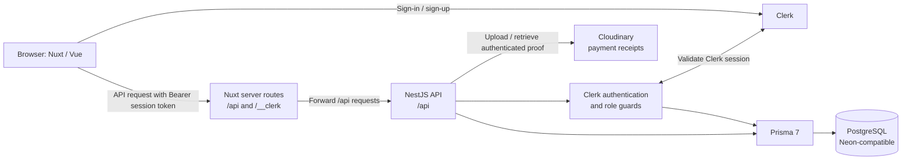
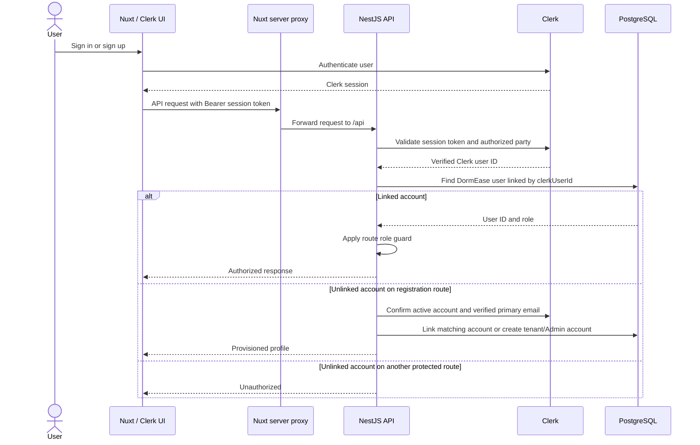

# DormEase

DormEase is a web-based dormitory management system for administrators, staff, and tenants. It brings room and tenant records, room assignments, payment tracking, and maintenance workflows together in one web application.

> **Implementation status:** This README describes the checked-in application. Some role-management and notification capabilities are not implemented; see [Key Features](#5-key-features) and [Known Limitations](#22-known-limitations).

## Table of Contents

1. [Project Overview](#1-project-overview)
2. [Project Description](#2-project-description)
3. [Problem Statement](#3-problem-statement)
4. [Project Objectives](#4-project-objectives)
5. [Key Features](#5-key-features)
6. [User Roles and Permissions](#6-user-roles-and-permissions)
7. [Technology Stack](#7-technology-stack)
8. [System Architecture](#8-system-architecture)
9. [Project Folder Structure](#9-project-folder-structure)
10. [Prerequisites](#10-prerequisites)
11. [Installation and Setup](#11-installation-and-setup)
12. [Environment Variables](#12-environment-variables)
13. [Database Setup and Prisma Migrations](#13-database-setup-and-prisma-migrations)
14. [Running the Development Server](#14-running-the-development-server)
15. [Building for Production](#15-building-for-production)
16. [API Documentation](#16-api-documentation)
17. [Authentication Flow](#17-authentication-flow)
18. [Deployment Guide](#18-deployment-guide)
19. [Testing](#19-testing)
20. [Troubleshooting](#20-troubleshooting)
21. [Security Considerations](#21-security-considerations)
22. [Known Limitations](#22-known-limitations)
23. [Future Improvements](#23-future-improvements)
24. [Contributors](#24-contributors)
25. [License](#25-license)

## 1. Project Overview

| Component | Implementation |
| --- | --- |
| Frontend | Nuxt 4, Vue 3, TypeScript |
| Backend | NestJS 12, TypeScript |
| Database | PostgreSQL through Prisma 7 and the `pg` adapter |
| Authentication | Clerk |
| Receipt storage | Cloudinary authenticated assets |
| Email library | Resend is referenced by an unconnected password-reset email service; it is not part of the current Clerk-based recovery flow |

The repository contains two independent npm applications: `frontend` and `backend`. There is no root `package.json`; install dependencies and run scripts from the relevant application directory.

## 2. Project Description

DormEase provides browser-based tools for managing a dormitory's rooms, tenant records, occupancy, payments, and maintenance requests. Administrators and staff use operational pages for shared records; tenants use a separate area to view their room, submit payment receipts, request room placement, and follow maintenance updates.

The backend exposes a JSON API under `/api`. The frontend calls it through a same-origin Nuxt server proxy, while Clerk supplies session authentication.

## 3. Problem Statement

Dormitory operations can become difficult to coordinate when tenant details, room assignments, bills, and maintenance issues are tracked in separate processes. DormEase aims to provide one application for these workflows, with role-aware access and a tenant self-service experience.

## 4. Project Objectives

- Centralize dormitory room, tenant, and assignment records.
- Help staff track payment records and verify tenant-submitted receipts.
- Give tenants access to their own room, payment, and maintenance information.
- Support invitation-based room requests with administrator approval.
- Protect API operations with authenticated sessions and role checks.

## 5. Key Features

The status below reflects code and UI present in this repository, not a production deployment review.

| Feature | Status | What is implemented |
| --- | --- | --- |
| Admin management | **Partial** | New administrator registration can be protected by `ADMIN_INVITATION_CODE`, and some actions are Admin-only. There is no UI or API for managing administrator accounts or changing roles. |
| Staff management | **Partial** | `STAFF` is a recognized role and staff share access to several operational endpoints. There is no staff directory or staff account-management workflow; the staff dashboard currently provides a welcome message and logout. |
| Tenant management | **Implemented** | Admin/staff pages and API support tenant records, profile edits, and deletion. A created tenant signs up through Clerk with the verified email to link the identity. Tenants can manage their own profile. |
| Room management | **Implemented** | Admin/staff can create, view, edit, and delete rooms, including building, floor, type, capacity, rent, description, and status. Rooms with assignment or maintenance history cannot be deleted. |
| Room assignments | **Implemented** | Admin/staff can assign eligible tenants to rooms and terminate active assignments. The backend checks capacity, room status, and existing active assignments. Approving an invitation request also creates an assignment. |
| Room invitations and QR codes | **Implemented** | Admin/staff can create expiring invitation codes, copy codes and links, generate/download QR images, and revoke active invitations. Tenants can request a room; approval and rejection are Admin-only. A request does not assign a room until approved. |
| Payment management | **Implemented** | Admin/staff can create bills and view payment records. Tenants can view their payments, outstanding balance, and submission history. |
| Payment proof verification | **Implemented** | Tenants can upload a receipt (JPG, PNG, WEBP, or PDF, up to 5 MB). Admin/staff can approve or reject submissions; rejected submissions require remarks. Verification history is stored. Proof viewing is authenticated and limited to the submitting tenant or Admin/staff. Cloudinary must be configured for receipt storage. |
| Maintenance requests | **Implemented** | Tenants with an active room assignment can submit private requests and view their own request history. Admin/staff can review requests, reject them privately, or approve them as announcements. Tenants can see approved announcements and progress updates. The board is available to authenticated tenant accounts, not anonymous visitors. |
| Authentication and role-based access control | **Implemented** | Clerk handles sign-in and sign-up. The API validates Clerk session tokens, maps the Clerk identity to a DormEase database user, and applies role guards. The frontend also redirects users away from routes for other roles. |

## 6. User Roles and Permissions

DormEase stores three roles: `ADMIN`, `STAFF`, and `TENANT`.

| Role | Current access |
| --- | --- |
| **Admin** | Can access the administrative dashboard and operational features. Admin-only operations include approving or rejecting room requests. New Admin registration requires the configured invitation code. |
| **Staff** | Can access several operational endpoints for rooms, tenants, assignments, payments, maintenance, dashboard summaries, and invitation creation/revocation. Staff cannot approve or reject room requests through the current API. The staff dashboard is currently minimal. |
| **Tenant** | Can view and update their own profile, view their room and payments, submit payment proof, submit and track maintenance requests, view approved maintenance announcements, and request a room using an invitation. Tenant-specific endpoints use the authenticated account rather than a client-supplied tenant ID. |

The backend is authoritative for authorization. Hiding or redirecting a frontend page is not a substitute for the API guards.

## 7. Technology Stack

### Frontend

- Nuxt 4 and Vue 3
- TypeScript
- Tailwind CSS through `@nuxtjs/tailwindcss`
- Clerk Nuxt components and client integration
- `qrcode` for invitation QR images

### Backend

- NestJS 12 and TypeScript
- Express platform adapter
- `class-validator` and `class-transformer` for request validation
- `@nestjs/throttler` for registration throttling

### Database

- PostgreSQL
- Prisma 7
- Prisma PostgreSQL driver adapter (`@prisma/adapter-pg` and `pg`)
- Prisma schema and checked-in SQL migrations in `backend/prisma`

### Authentication

- Clerk manages sign-in, sign-up, sessions, and password recovery.
- The backend uses `@clerk/backend` to validate session tokens and look up the linked DormEase user and role.

### Deployment and hosting

The repository's run guide describes Vercel for the frontend, Render for the backend, and Neon for PostgreSQL. There are no checked-in Vercel or Render deployment manifests, so these are deployment targets rather than repository-verified deployments.

### Other services and libraries

- Cloudinary stores payment receipt uploads as authenticated assets.
- Resend is present in a password-reset email service class, but that service is not registered in the current authentication module or used by the Clerk recovery UI.
- RxJS is included with NestJS.
- Jest and Supertest dependencies support backend tests.

## 8. System Architecture



In the deployed Nuxt application, browser API calls use the same-origin `/api` route. The Nuxt server route forwards those requests to `NUXT_API_BASE_URL` (or its documented fallback). The API listens on `/api`, validates the Clerk session, checks the mapped database user's role where required, and accesses PostgreSQL through Prisma.

## 9. Project Folder Structure

The following is a source-focused view of the repository; dependency directories such as `node_modules` and generated build output are omitted.

```text
dormease/
├── API                         # Existing API endpoint notes
├── RUN GUIDE                   # Existing local/deployment notes
├── package-lock.json           # Root lockfile; there is no root package.json
├── backend/
│   ├── prisma/
│   │   ├── migrations/         # 11 checked-in SQL migration directories
│   │   ├── schema.prisma
│   │   └── migration_lock.toml
│   ├── src/
│   │   ├── assignments/
│   │   ├── auth/
│   │   ├── cloudinary/
│   │   ├── dashboard/
│   │   ├── generated/prisma/   # Generated Prisma client
│   │   ├── maintenance/
│   │   ├── notifications/
│   │   ├── payments/
│   │   ├── prisma/
│   │   ├── room-invitations/
│   │   ├── rooms/
│   │   ├── tenants/
│   │   ├── app.controller.ts
│   │   ├── app.module.ts
│   │   ├── app.service.ts
│   │   └── main.ts
│   ├── test/                   # Jest end-to-end test and config
│   ├── package.json
│   ├── prisma7.config.ts
│   └── tsconfig.json
└── frontend/
    ├── app/
    │   ├── assets/css/
    │   ├── components/
    │   │   ├── dashboard/
    │   │   ├── layout/
    │   │   ├── payments/
    │   │   └── ui/
    │   ├── composables/
    │   ├── layouts/
    │   ├── middleware/
    │   ├── pages/
    │   │   ├── account.vue
    │   │   ├── dashboard.vue
    │   │   ├── forgot-password.vue
    │   │   ├── index.vue
    │   │   ├── login.vue
    │   │   ├── profile.vue
    │   │   ├── register.vue
    │   │   ├── reset-password.vue
    │   │   ├── admin/
    │   │   │   └── dashboard.vue
    │   │   ├── assignments/
    │   │   │   └── index.vue
    │   │   ├── auth/
    │   │   │   └── complete.vue
    │   │   ├── invitations/
    │   │   │   ├── accept/[code].vue
    │   │   │   └── index.vue
    │   │   ├── maintenance/
    │   │   │   └── index.vue
    │   │   ├── payments/
    │   │   │   └── index.vue
    │   │   ├── rooms/
    │   │   │   └── index.vue
    │   │   ├── register/
    │   │   │   └── [...slug].vue
    │   │   ├── staff/
    │   │   │   └── dashboard.vue
    │   │   ├── tenant/
    │   │   │   ├── dashboard.vue
    │   │   │   ├── join-room.vue
    │   │   │   ├── maintenance.vue
    │   │   │   ├── payments.vue
    │   │   │   ├── profile.vue
    │   │   │   └── room.vue
    │   │   ├── tenants/
    │   │       └── index.vue
    │   ├── services/
    │   ├── types/
    │   └── app.vue
    ├── public/
    ├── server/routes/
    │   ├── __clerk/
    │   └── api/
    ├── nuxt.config.ts
    └── package.json
```

## 10. Prerequisites

- Node.js and npm versions supported by the installed Nuxt and NestJS dependencies. The repository does not pin a Node.js version.
- A PostgreSQL database for local development or a hosted database such as Neon.
- A Clerk application with frontend and backend keys.
- Cloudinary credentials if testing payment proof uploads and retrieval.
- Git to clone the repository.

## 11. Installation and Setup

Clone the repository and enter its directory:

```bash
git clone https://github.com/Johnpaul143904/dormease.git
cd dormease
```

Install dependencies separately for each application:

```bash
cd backend
npm ci
cd ../frontend
npm ci
```

Configure environment variables as described in [Environment Variables](#12-environment-variables). Before starting the backend, generate the Prisma client and apply the existing migrations to the configured database; see [Database Setup and Prisma Migrations](#13-database-setup-and-prisma-migrations).

## 12. Environment Variables

Do not commit `.env` files. Use the deployment platform's secret/environment settings in hosted environments. Values below are placeholders, not real credentials.

### Backend

Create `backend/.env` for local development:

```dotenv
DATABASE_URL="postgresql://<user>:<password>@<host>:5432/<database>?sslmode=require"
CLERK_SECRET_KEY="<clerk-secret-key>"
CLERK_PUBLISHABLE_KEY="<clerk-publishable-key>"
CLERK_AUTHORIZED_PARTIES="http://localhost:3000"
CORS_ORIGIN="http://localhost:3000"
PORT="3001"
NODE_ENV="development"
ADMIN_INVITATION_CODE="<long-random-admin-invitation-code>"
CLOUDINARY_CLOUD_NAME="<cloudinary-cloud-name>"
CLOUDINARY_API_KEY="<cloudinary-api-key>"
CLOUDINARY_API_SECRET="<cloudinary-api-secret>"
```

| Variable | Required | Purpose |
| --- | --- | --- |
| `DATABASE_URL` | Yes | PostgreSQL connection string used by Prisma's PostgreSQL adapter and Prisma CLI configuration. |
| `CLERK_SECRET_KEY` | Yes | Server-side key used by the backend Clerk client. Keep it private. |
| `CLERK_PUBLISHABLE_KEY` | Yes | Publishable key supplied to the backend Clerk client. |
| `CLERK_AUTHORIZED_PARTIES` | Recommended | Comma-separated allowed frontend origins for Clerk session validation. If omitted, the backend uses `CORS_ORIGIN`, then defaults to `http://localhost:3000`. |
| `CORS_ORIGIN` | Required in production | Comma-separated origins allowed by the NestJS CORS configuration. Defaults to `http://localhost:3000` outside production; the application refuses to start in production without this variable. |
| `PORT` | Optional | API listening port; defaults to `3001`. Render normally supplies this value. |
| `NODE_ENV` | Optional | The API uses `production` to require explicit `CORS_ORIGIN`. |
| `ADMIN_INVITATION_CODE` | Conditional | Required to provision a new Admin through the registration flow. Do not share it publicly. |
| `CLOUDINARY_CLOUD_NAME` | Conditional | Cloudinary account name. Required when receipt storage is used. |
| `CLOUDINARY_API_KEY` | Conditional | Cloudinary server-side API key. Required when receipt storage is used. |
| `CLOUDINARY_API_SECRET` | Conditional | Cloudinary server-side API secret. Never expose it to the browser. |

The backend also references the following variables in `PasswordResetEmailService`:

- `RESEND_API_KEY`: Resend API credential used to send an email.
- `RESEND_FROM_EMAIL`: sender address supplied to Resend.

That service is not currently registered or called by the application, so these variables are **not required for the implemented Clerk password-recovery flow**.

### Frontend

Create `frontend/.env` for local development:

```dotenv
NUXT_PUBLIC_CLERK_PUBLISHABLE_KEY="<clerk-publishable-key>"
NUXT_CLERK_SECRET_KEY="<clerk-secret-key>"
NUXT_API_BASE_URL="http://localhost:3001/api"
```

| Variable | Required | Purpose |
| --- | --- | --- |
| `NUXT_PUBLIC_CLERK_PUBLISHABLE_KEY` | Yes | Public Clerk key used by the frontend. |
| `NUXT_CLERK_SECRET_KEY` | Yes for the Clerk proxy | Server-only Clerk key used by the Nuxt `/__clerk` proxy. Never prefix this secret with `NUXT_PUBLIC_`. |
| `NUXT_API_BASE_URL` | Optional locally; set for deployments | Backend API base URL, normally ending in `/api`. Defaults to `http://localhost:3001/api`. |

Compatibility fallbacks in `frontend/nuxt.config.ts` are `CLERK_PUBLISHABLE_KEY`, `CLERK_SECRET_KEY`, and `NUXT_PUBLIC_API_BASE_URL`. Prefer the `NUXT_...` names above. Do not put secret keys in public variables or client-side code.

## 13. Database Setup and Prisma Migrations

The Prisma schema is `backend/prisma/schema.prisma`. It defines users and roles, tenant profiles, rooms, assignments, payments and proof submissions, maintenance requests and status history, room invitations, notification logs, and supporting records.

The repository contains 11 migration directories. To apply pending migrations to the database configured by `DATABASE_URL`, run these commands from `backend`:

```bash
npx prisma generate --config prisma7.config.ts
npx prisma migrate deploy --config prisma7.config.ts
```

`migrate deploy` applies checked-in migrations; it does not create a development migration. Review migrations and back up important data before applying them to a production database. Do not use `prisma migrate reset` against data you need to keep. No seed script is declared in the backend package.

## 14. Running the Development Server

Start the backend from one terminal:

```bash
cd backend
npm run start:dev
```

Start the frontend from a second terminal:

```bash
cd frontend
npm run dev
```

By default, the frontend is at `http://localhost:3000` and the API is at `http://localhost:3001/api`. The API's `GET /api` route returns the NestJS greeting; it is not a detailed health-check endpoint.

## 15. Building for Production

Build the backend from `backend`:

```bash
npm ci
npx prisma generate --config prisma7.config.ts
npm run build
npm run start:prod
```

Build and preview the frontend from `frontend`:

```bash
npm ci
npm run build
npm run preview
```

The frontend's `preview` script previews the Nuxt production build. Production environment variables must be configured in the hosting platform before the service starts.

## 16. API Documentation

The API uses the global prefix `/api`. There is no generated OpenAPI/Swagger specification in the current backend. All routes below are based on the NestJS controllers.

Protected API calls require:

```http
Authorization: Bearer <Clerk-session-token>
```

| Method | Path | Access | Purpose |
| --- | --- | --- | --- |
| `GET` | `/api` | Public | Returns the root greeting. |
| `POST` | `/api/auth/register` | Authenticated Clerk session, including an unlinked identity | Links a matching account or provisions a tenant; new Admin registration requires the configured invitation code. |
| `GET`, `PATCH` | `/api/auth/profile` | Authenticated linked user | Read or update the current user's profile. |
| `GET` | `/api/dashboard/summary` | Admin, Staff | Read dashboard summary counts. |
| `GET`, `POST` | `/api/rooms` | Admin, Staff | List or create rooms. |
| `GET`, `PATCH`, `DELETE` | `/api/rooms/:id` | Admin, Staff | Read, update, or delete a room. |
| `GET` | `/api/tenants` | Admin, Staff | List tenants. |
| `GET` | `/api/tenants/me` | Tenant | Read the current tenant's record. |
| `GET`, `PATCH`, `DELETE` | `/api/tenants/:id` | Admin, Staff | Read, update, or delete a tenant. |
| `POST` | `/api/tenants` | Admin, Staff | Create a tenant record. |
| `GET`, `POST` | `/api/assignments` | Admin, Staff | List or create room assignments. |
| `PATCH` | `/api/assignments/:id/terminate` | Admin, Staff | Complete an active assignment. |
| `GET` | `/api/room-invitations` | Admin, Staff | List invitations and room requests. |
| `GET` | `/api/room-invitations/me` | Tenant | List the current tenant's invitation requests. |
| `POST` | `/api/room-invitations` | Admin, Staff | Create an invitation. |
| `GET` | `/api/room-invitations/:code` | Public | Read invitation status and limited room details. |
| `POST` | `/api/room-invitations/:code/request` | Tenant | Request to join the invited room. |
| `POST` | `/api/room-invitations/:id/approve` | Admin | Approve a pending request and create its assignment. |
| `POST` | `/api/room-invitations/:id/reject` | Admin | Reject a pending request. |
| `POST` | `/api/room-invitations/:id/revoke` | Admin, Staff | Revoke an active invitation. |
| `GET` | `/api/payments` | Admin, Staff | List payments. |
| `GET` | `/api/payments/me` | Tenant | List the current tenant's payments and proof submissions. |
| `POST` | `/api/payments` | Admin, Staff | Create an unpaid payment record. |
| `PATCH` | `/api/payments/:id` | Admin, Staff | Update payment details. |
| `GET` | `/api/payments/submissions` | Admin, Staff | List proof submissions and verification details. |
| `GET` | `/api/payments/submissions/:submissionId/proof` | Admin, Staff, owning Tenant | View/download a receipt through the authenticated API. |
| `POST` | `/api/payments/:paymentId/submissions` | Tenant | Submit multipart payment proof. File field: `proof`; allowed types: JPG, PNG, WEBP, PDF; maximum size: 5 MB. |
| `PATCH` | `/api/payments/submissions/:submissionId/verify` | Admin, Staff | Approve or reject proof; rejection requires remarks. |
| `GET` | `/api/maintenance` | Admin, Staff | List maintenance requests. |
| `GET`, `POST` | `/api/maintenance/me` | Tenant | List or create the current tenant's maintenance requests. |
| `GET` | `/api/maintenance/public` | Authenticated Tenant | List approved announcements without tenant or room identifiers. |
| `POST` | `/api/maintenance` | Admin, Staff | Create a maintenance request on behalf of a tenant. |
| `PATCH` | `/api/maintenance/:id/approve` | Admin, Staff | Approve a request and publish announcement fields. |
| `PATCH` | `/api/maintenance/:id/reject` | Admin, Staff | Reject a pending request, keeping it private. |
| `PATCH` | `/api/maintenance/:id` | Admin, Staff | Update an approved announcement or its progress status. |

There are currently no notification endpoints, staff-management endpoints, or backend forgot/reset-password endpoints. Password recovery is handled in Clerk. The invitation lookup route is explicitly public; the maintenance endpoint named `public` is still restricted to authenticated tenants.

## 17. Authentication Flow



Clerk owns credentials and session lifecycle. The frontend sends a Clerk session token in the `Authorization` header. The backend validates it against configured authorized parties and loads the database user's role; it does not accept a role supplied by the browser. Registration can link an existing matching account or create an account. A tenant account is created by default unless the Admin registration path and invitation code are used.

## 18. Deployment Guide

The checked-in configuration does not include `vercel.json`, `render.yaml`, or a Dockerfile. The following settings are derived from the app scripts and runtime configuration; deployment has not been verified from this repository.

### Frontend on Vercel

1. Create a Vercel project connected to this repository.
2. Set the project **Root Directory** to `frontend`.
3. Use `npm ci` to install dependencies and `npm run build` to build the Nuxt application.
4. Configure:
   - `NUXT_PUBLIC_CLERK_PUBLISHABLE_KEY`
   - `NUXT_CLERK_SECRET_KEY` as a server-only secret
   - `NUXT_API_BASE_URL` to the deployed Render API URL ending in `/api`, for example `https://<render-service-host>/api`
5. Add the deployed frontend origin to the backend's `CORS_ORIGIN` and `CLERK_AUTHORIZED_PARTIES`.

Use the Nuxt/Vercel integration's detected output and runtime settings; this repository does not specify a custom Vercel build or output configuration.

### Backend on Render

1. Create a Render web service for this repository and set its **Root Directory** to `backend`.
2. Use a build command equivalent to:

   ```bash
   npm ci && npx prisma generate --config prisma7.config.ts && npm run build
   ```

3. Use `npm run start:prod` as the start command.
4. Configure the backend environment variables from [Environment Variables](#12-environment-variables), including `DATABASE_URL`, Clerk keys, and `CORS_ORIGIN`. Set `CLERK_AUTHORIZED_PARTIES` to the deployed frontend origin.
5. Configure the Cloudinary variables if tenants will submit payment proof.
6. Run reviewed Prisma migrations as a separate deployment step; do not assume the application start command applies migrations.

Render supplies `PORT`; the NestJS application listens on `0.0.0.0` and uses that value.

### Database on Neon

1. Create a PostgreSQL project/database in Neon.
2. Copy its PostgreSQL connection string into the backend's `DATABASE_URL` setting. Keep the connection string private.
3. From the backend directory, generate the Prisma client and apply pending migrations:

   ```bash
   npx prisma generate --config prisma7.config.ts
   npx prisma migrate deploy --config prisma7.config.ts
   ```

4. Confirm the deployment environment can reach the Neon database before starting the API.

The repository config reads `DATABASE_URL`; no separate migration/direct connection variable is defined in the checked-in Prisma configuration.

## 19. Testing

Run backend tests from `backend`:

```bash
npm test
npm run test:e2e
npm run test:cov
npm run lint
```

The backend contains Jest unit tests across authentication, rooms, tenants, assignments, invitations, payments, maintenance, Cloudinary, and dashboard modules, plus an end-to-end test under `backend/test`. The frontend package does not declare a test script.

## 20. Troubleshooting

| Symptom | Checks |
| --- | --- |
| Backend cannot connect to PostgreSQL | Check `DATABASE_URL`, database availability, network access, and TLS requirements for the selected provider. |
| Prisma reports a missing or stale client | From `backend`, run `npx prisma generate --config prisma7.config.ts`. |
| Backend fails Clerk initialization | Confirm `CLERK_SECRET_KEY` and `CLERK_PUBLISHABLE_KEY` are set in the backend environment. |
| API returns unauthorized for a signed-in user | Confirm the frontend sends a Clerk session token, the Clerk account has a verified primary email, and its identity is linked to a DormEase user. |
| Clerk rejects the session due to origin | Set `CLERK_AUTHORIZED_PARTIES` to the exact frontend origin, including scheme and port where applicable. |
| Browser API request fails due to CORS | Set `CORS_ORIGIN` to the frontend origin. In production the backend requires this setting. |
| Receipt upload or retrieval is unavailable | Configure all three backend Cloudinary variables and confirm the Cloudinary account is available. |
| Admin sign-up is denied | Set `ADMIN_INVITATION_CODE` on the backend and enter the matching code in the registration flow. |
| Frontend points at the wrong API | Set `NUXT_API_BASE_URL` to the backend API origin ending in `/api`; rebuild/redeploy the frontend after changing build-time settings. |

## 21. Security Considerations

- Never commit `.env` files, API keys, passwords, database URLs, Clerk secrets, or Cloudinary secrets.
- Keep `NUXT_CLERK_SECRET_KEY`, backend Clerk credentials, Cloudinary credentials, and database credentials in server-side secret storage. Never expose them through `NUXT_PUBLIC_` variables.
- Use HTTPS for deployed frontend and API origins and configure exact allowed origins.
- Use a strong, private `ADMIN_INVITATION_CODE`; restrict access to administrator provisioning.
- API endpoints are protected by a global Clerk guard unless explicitly marked public, and role-restricted endpoints use a second guard.
- Tenant-specific API operations derive the tenant from the authenticated account. Receipt retrieval checks tenant ownership or an Admin/Staff role.
- Payment proof is limited to 5 MB and JPG, PNG, WEBP, or PDF. The API delivers stored proof through an authenticated endpoint with private/no-store caching headers.
- Review and back up production data before applying database migrations. Do not use destructive reset commands on a production database.

## 22. Known Limitations

- Staff account creation, staff-directory management, and role administration are not implemented. The staff dashboard is currently a placeholder.
- The role model includes Admin-only invitation approval, but otherwise Admin and Staff share many operational permissions; there is no granular permission-management UI.
- Notification controller and service classes are empty; automated payment, room-invitation, and maintenance notifications are not implemented.
- Forgot/reset password routes in the frontend direct users to Clerk. Backend password-reset token schema/email code exists but is not wired into the current authentication module.
- No OpenAPI/Swagger API specification is configured.
- The frontend has no declared automated test script.
- Vercel, Render, and Neon are described as targets in the existing guide, but platform-specific deployment manifests and a verified deployment are not present in the repository.
- No seed script is declared. Initial user and dormitory data must be provisioned through the application or another approved process.

## 23. Future Improvements

These are suggestions, not implemented features:

- Add Admin workflows for managing Staff accounts and role assignments.
- Build a complete staff dashboard and review whether operational permissions should differ by role.
- Implement notifications for payment verification, invitation decisions, and maintenance updates.
- Add frontend tests and expand API integration coverage.
- Publish an OpenAPI specification and keep it synchronized with controller behavior.
- Add documented, repeatable deployment and migration automation with environment-specific safeguards.
- Decide whether password recovery should remain entirely in Clerk or whether the unused backend reset scaffolding should be completed or removed.

## 24. Contributors

See the [DormEase repository contributors page](https://github.com/Johnpaul143904/dormease/graphs/contributors) for the current contributor list. The package metadata does not declare individual authors.

## 25. License

No root-level license file is present, and the backend package declares `UNLICENSED`. No open-source license grant can be inferred from the repository. Confirm licensing with the project owner before redistributing or reusing the code.
